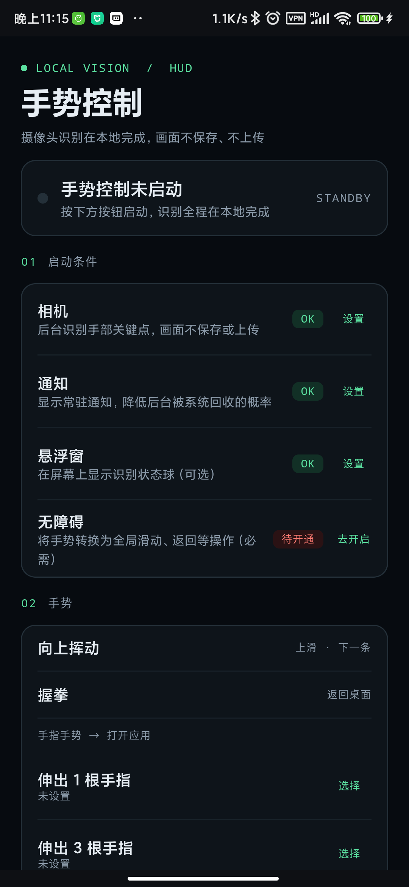
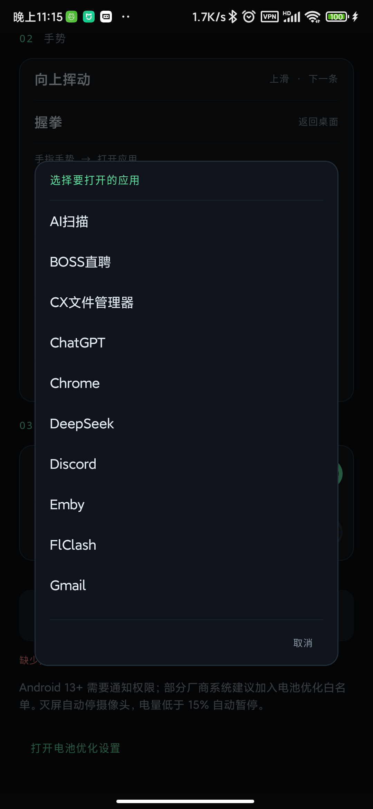

<div align="center">
  
  <h1>手势控制 · Hand Motion Detector</h1>
  <p>用摄像头识别手势，隔空全局控制安卓手机。</p>
  <p>全部识别在本地完成，画面不保存、不上传。</p>

  [](https://github.com/CheserEri/hand-motion-detector/releases/latest)
  [](#下载与安装)
  [](#技术栈)
</div>

---

## 这是什么

手机开着摄像头，你在镜头前挥手就能操作手机：刷下一条视频、返回桌面、打开指定应用。不需要触碰屏幕，也不依赖语音。

识别只用 MediaPipe 手部关键点，在设备端实时推理；App 只负责把识别结果通过无障碍服务注入系统手势，不读取屏幕内容。

## 手势

| 手势 | 动作 |
| --- | --- |
| 手掌自下向上轻快挥动 | 全局上滑（抖音 / 小红书「下一条」） |
| 握拳 | 返回桌面 |
| 伸出 1 根手指 | 打开为「1 指」指定的应用 |
| 伸出 3 根手指 | 打开为「3 指」指定的应用 |
| 伸出 4 根手指（拇指需收拢） | 打开为「4 指」指定的应用 |
| 比 ✌ | 开启 / 关闭其他手势，本身不执行动作 |

设计上刻意只保留向上挥动：向下挥动是抬手与收手的自然动作，识别它必然误触。拇指外伸的张开手掌不会被判成「4 根手指」。手指手势与握拳只在手停稳时识别，挥动过程不参与判定。

## 界面

<table>
  <tr>
    <td width="50%"></td>
    <td width="50%"></td>
  </tr>
  <tr>
    <td align="center">深色 HUD 主界面：权限状态、手势映射、偏好开关</td>
    <td align="center">为手指手势选择要打开的应用</td>
  </tr>
</table>

运行后屏幕左侧会出现一个可拖动的状态球，实时显示「无手 / 静止 / 上 / 握拳 / 1 指 / 手势已关闭」等识别结果。

## 下载与安装

1. 到 [Releases](https://github.com/CheserEri/hand-motion-detector/releases/latest) 下载 `app-release.apk`，传到手机上安装（Android 8.0 及以上）。
2. 打开 App，逐个开通：
   - **相机**：识别手部关键点（必需）
   - **通知**：显示常驻通知，降低后台被系统回收的概率
   - **悬浮窗**：显示状态球（可选）
   - **无障碍**：把识别结果转成全局手势（必需，需在系统设置里手动开启）
3. 建议把 App 加入电池优化白名单，避免后台被清理。
4. 回到 App 点击「启动手势控制」，看到状态变为 `ACTIVE` 即可使用。

> 好消息：识别不依赖网络，飞行模式下也能用。

## 识别与低功耗

- **采集**：CameraX `ImageAnalysis`，320×240、约 15fps，`KEEP_ONLY_LATEST`，不渲染预览。
- **推理**：MediaPipe `HandLandmarker` LIVE_STREAM，单手，优先 GPU，失败自动回退 CPU。
- **降频**：无手 1 秒后降到约 8fps；灭屏自动停摄像头；电量低于 15% 自动暂停。
- **手势切割**：一次手势触发后立即进入未武装状态，必须同时满足 450ms 静默与手部真正停稳（250ms 窗口内累计路程小于 0.25 手长，来回摆动不算停稳）才重新武装。手没回撤、没停稳之前不会识别下一个手势。
- **意图判定**：在最近 500ms 内找幅度最大、速度最快、方向一致的那一段（≥0.25 手长、≥1.2 手长/秒、同向占比 ≥75%），所以轻快上挥一下就能触发，慢速预备动作不触发。
- **稳定性**：手尺度归一化（腕点→中指 MCP）、One-Euro 滤波、食指尖竖直位移 + 掌心同向移动 + 手指张开度联合判定；握拳与手指数使用角度滞回与稳定帧数。

## 从源码构建

```bash
cd android
# 需要 JDK 17 与 Android SDK（compileSdk 35）
./gradlew assembleDebug
```

或在 Android Studio 中打开 `android/` 目录直接运行。模型文件已随仓库提供：`android/app/src/main/assets/hand_landmarker.task`（缺失时可从 [MediaPipe 模型库](https://storage.googleapis.com/mediapipe-models/hand_landmarker/hand_landmarker/float16/1/hand_landmarker.task) 下载）。

手势引擎是纯 Kotlin 实现，可跑单元测试：

```bash
cd android && ./gradlew testDebugUnitTest
```

### 技术栈

Kotlin · Jetpack Compose（Material 3，深色 HUD 主题）· CameraX · MediaPipe Tasks Vision · AccessibilityService · 前台服务 · 无预览渲染。

## 隐私

- 摄像头画面只在内存中处理，不解码保存、不上传、不写日志。
- 不使用网络权限，全部推理在本地完成。
- 无障碍服务只用于注入滑动/返回/启动应用，不读取屏幕文本。

## 项目结构

```
android/                                  # 安卓 App（Gradle 工程）
├── app/src/main/
│   ├── assets/hand_landmarker.task        # MediaPipe 手部模型
│   ├── res/                               # 自适应图标、主题、无障碍配置
│   └── java/com/chesereri/handmotiondetector/
│       ├── MainActivity.kt                # Compose 权限引导与设置界面
│       ├── service/GestureCameraService.kt# 前台摄像头 + 识别循环
│       ├── service/HandAccessibilityService.kt # 全局手势注入
│       ├── overlay/OverlayBadge.kt        # 可拖动状态球
│       ├── vision/GestureEngine.kt        # 纯 Kotlin 手势识别（可单测）
│       ├── vision/HandLandmarkerHelper.kt # MediaPipe 封装
│       ├── vision/OneEuroFilter.kt        # 关键点平滑
│       └── vision/ImageProxyExt.kt        # 相机帧转位图
└── app/src/test/                          # 手势引擎单元测试

main.py                                   # 桌面版（Python + PyQt5）入口
src/                                      # 桌面版源码
docs/                                     # README 截图
```

## 桌面版（Python）

仓库里还保留最初的桌面实验版本：PyQt5 界面 + MediaPipe，用于观察手部关键点、轨迹和调参。

```bash
python -m venv .venv
.venv\Scripts\activate          # macOS/Linux: source .venv/bin/activate
pip install -r requirements.txt
python main.py
```

它支持挥手、抓取/释放、上下左右滑动和画圈的可视化演示，识别参数在 `config.yaml` 中调整（方向阈值、平滑窗口、弯曲角阈值、检测置信度等）。安卓版是重新设计的精简实现，只保留实际可用的手势。

## 已知限制

- 无障碍服务必须由用户在系统设置手动开启，App 无法代劳。
- Android 14 起相机前台服务需从可见界面启动，请务必点 App 内按钮，不要用第三方工具拉起。
- 部分厂商系统（MIUI / EMUI 等）会限制后台，建议加入电池优化白名单。
- 光线过暗或手离镜头太远时识别率会下降，保持手部完整入镜、距离 30–60cm 效果最好。
